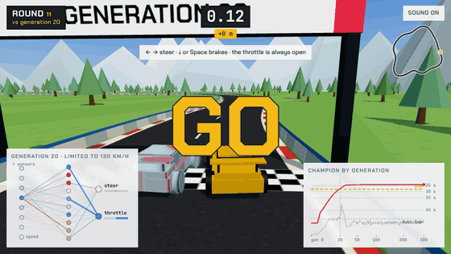
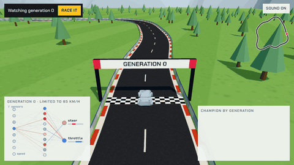

# Learning Curve

A 3D racing game where your opponent is a neural network that has never driven a car. It learns between your laps. You win a round by finishing first; the game ends the first time it beats you.

**[Play it in your browser](https://nandhu-44.github.io/learning-curve/)**



Everything runs in the page: no server, no model files, no ML library. The network, the genetic algorithm that trains it, the physics and the track generator are a few hundred lines of TypeScript in [`src/sim`](src/sim), and the scenery and cars are built in code with three.js.

## How to play

| | Keyboard | Touch |
|---|---|---|
| Steer | `←` `→` or `A` `D` | drag sideways on the left of the screen |
| Brake | `↓`, `S` or `Space` | hold the right of the screen |

The throttle is always open, so driving is steering and braking. Touching a wall slows you down. For the network, touching a wall ends its lap.

Each round you race one lap against a later generation. With no track in the address you get the track of the day, the same for everyone; `?track=1234` picks a specific one and **New track** rolls a random one. A track always produces the same sequence of rivals, so you can compare how many rounds you lasted on it.

## How it learns



**The driver** is a small fully connected network: 8 inputs, 10 `tanh` units, 2 outputs, 112 weights in total. The inputs are seven distance sensors fanned across the nose of the car plus its speed. The outputs are steering and throttle. The panel in the corner of the game shows this network live while it drives.

**Training is neuroevolution.** There are no gradients and no training data. Sixty random networks each drive one lap. The ones that got furthest, or finished fastest, are copied, crossed with each other and mutated to make the next sixty; the best four carry over unchanged. Training runs in a Web Worker while you play.

**It follows a curriculum.** Learners start with a speed limit of 65 km/h. Every generation whose champion completes the lap raises the limit by 3.6 km/h, up to the same 166 km/h you have. A line that worked at the old speed runs wide at the new one, so the network has to keep adapting, and eventually has to learn to brake.

**Your rival is the best network found so far.** Usually that is the newest generation's champion. When a raised limit leaves a whole generation in the wall for a while, the previous record holder keeps the seat, so the opponent never gets slower.

The numbers below are from track 1 and come from `npm run curve -- 1`. A hand-written reference driver (aim at the centreline ahead, brake for the tightest bend in range) laps this track in 27.95 s; it loses to generation 20.

| Round | Generation | Speed limit | Rival's lap |
|---|---|---|---|
| 1 | 0 | 65 km/h | crashes 74% of the way round |
| 2 | 2 | 65 km/h | 46.92 s |
| 4 | 6 | 79 km/h | 38.97 s |
| 6 | 10 | 94 km/h | 33.86 s |
| 8 | 14 | 108 km/h | 30.58 s |
| 10 | 18 | 122 km/h | 28.32 s |
| 11 | 20 | 130 km/h | 27.39 s |
| 13 | 24 | 144 km/h | 25.90 s |
| 15 | 28 | 158 km/h | 24.75 s |
| 16 | 34 | 166 km/h | 24.56 s (generation 34 itself is crashing; an earlier one keeps the seat) |
| 18 | 300 | 166 km/h | 24.27 s |

There are 18 rounds. If you are still ahead of generation 300, you have out-driven a network that has stopped improving.

## Run it locally

```bash
npm install
npm run dev        # the game, with hot reload
npm test           # 52 tests, about 15 seconds
npm run curve -- 1 2 3   # print the learning curve for tracks 1, 2 and 3
npm run build      # production build in dist/
```

Requires Node 22 or newer.

### What the tests prove

- A track is the same for the same seed, has no bend tighter than 16 m, and its distance field matches its geometry (16 seeds).
- The reference driver completes a clean lap of eight different tracks, and a lap replays exactly.
- A learner is retired when it hits a wall, stalls or runs out of time; the human car scrapes along walls instead.
- On two tracks the network's first laps are slow, its speed limit only rises after a clean lap, its rival never gets slower, and at full speed it beats the reference driver.
- Training is reproducible: the same seed yields the same champion.

## How it is put together

```
src/sim/        no DOM, no three.js: runs the same in the browser, the worker and Node
  track.ts      seeded closed circuit in polar form, plus a distance field for fast sensor rays
  car.ts        fixed-step arcade physics; grip limits how tight a line can be at speed
  brain.ts      the network: sensors in, steering and throttle out
  evolve.ts     the genetic algorithm, the speed-limit curriculum, the rival record
  autopilot.ts  the hand-written reference driver
src/worker/     background training
src/game/       three.js world, game loop, input, sound, the network and chart panels
tests/          Vitest suites for everything in src/sim
scripts/        learning-table.ts, the source of the numbers above
```

A few details that mattered:

- **Determinism.** The simulation advances in fixed 1/60 s steps and every random number comes from a seeded generator, so a brain trained in the worker drives the identical lap when it is replayed on screen.
- **The track is star-shaped.** It is a circle bent by a few seeded harmonics, `r(θ)`, so it cannot cross itself and "how far round the lap is this car" is just the angle of its position.
- **Sensor rays are sphere-traced** through a precomputed distance-to-centreline grid, which keeps a generation of sixty laps to about 150 ms.

## Address options

| Option | Effect |
|---|---|
| `?track=N` | Use track `N` instead of the track of the day |
| `?autopilot` | The reference driver takes your seat: a demo of a full game |
| `?capture` | Stops the real-time loop and exposes `window.__lc` for frame-exact recording; this is how the GIFs above were made |

## License

[MIT](LICENSE)
